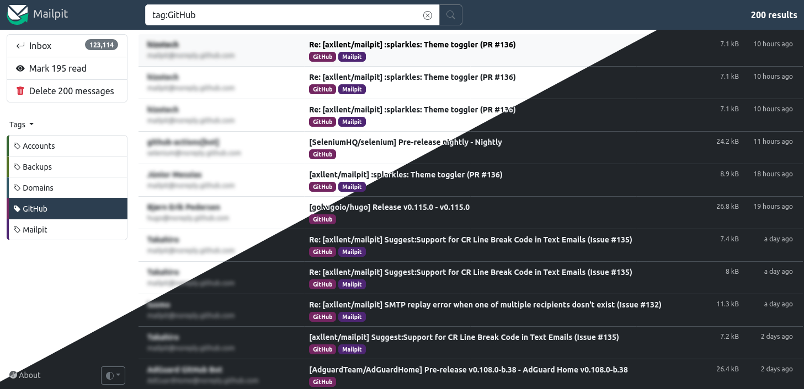

<h1 align="center">
  Mailpit - email testing for developers
</h1>

<div align="center">
    <a href="https://github.com/axllent/mailpit/actions/workflows/tests.yml"></a>
    <a href="https://github.com/axllent/mailpit/actions/workflows/build-release.yml"></a>
    <a href="https://github.com/axllent/mailpit/actions/workflows/build-docker.yml"></a>
    <a href="https://github.com/axllent/mailpit/actions/workflows/codeql-analysis.yml"></a>
    <br>
    <a href="https://github.com/axllent/mailpit/releases/latest"></a>
    <a href="https://hub.docker.com/r/axllent/mailpit"></a>
</div>
<br>
<p align="center">
  <a href="https://mailpit.axllent.org">Website</a>  •
  <a href="https://mailpit.axllent.org/docs/">Documentation</a>  •
  <a href="https://mailpit.axllent.org/docs/api-v1/">API</a>
</p>

<hr>

**Mailpit** is a small, fast, low memory, zero-dependency, multi-platform email testing tool & API for developers.

It acts as an SMTP server, provides a modern web interface to view & test captured emails, and includes an API for automated integration testing.

Mailpit was originally **inspired** by MailHog which is [no longer maintained](https://github.com/mailhog/MailHog/issues/442#issuecomment-1493415258) and hasn't seen active development or security updates for a few years now.




## Features

- Runs entirely from a single [static binary](https://mailpit.axllent.org/docs/install/) or multi-architecture [Docker images](https://mailpit.axllent.org/docs/install/docker/)
- Modern web UI with advanced [mail search](https://mailpit.axllent.org/docs/usage/search-filters/) to view emails (formatted HTML, highlighted HTML source, text, headers, raw source, and MIME attachments
including image thumbnails), including optional [HTTPS](https://mailpit.axllent.org/docs/configuration/http/) & [authentication](https://mailpit.axllent.org/docs/configuration/http/)
- [SMTP server](https://mailpit.axllent.org/docs/configuration/smtp/) with optional STARTTLS or SSL/TLS, authentication (including an "accept any" mode)
- A [REST API](https://mailpit.axllent.org/docs/api-v1/) for integration testing
- Real-time web UI updates using web sockets for new mail & optional [browser notifications](https://mailpit.axllent.org/docs/usage/notifications/) when new mail is received
- Optional [POP3 server](https://mailpit.axllent.org/docs/configuration/pop3/) to download captured message directly into your email client
- [HTML check](https://mailpit.axllent.org/docs/usage/html-check/) to test & score mail client compatibility with HTML emails
- [Link check](https://mailpit.axllent.org/docs/usage/link-check/) to test message links (HTML & text) & linked images
- [Spam check](https://mailpit.axllent.org/docs/usage/spam-check/) to test message "spamminess" using a running SpamAssassin and/or Rspamd server
- [Create screenshots](https://mailpit.axllent.org/docs/usage/html-screenshots/) of HTML messages via web UI
- Mobile and tablet HTML preview toggle in desktop mode
- [Message tagging](https://mailpit.axllent.org/docs/usage/tagging/) including manual tagging or automated tagging using filtering and "plus addressing"
- [SMTP relaying](https://mailpit.axllent.org/docs/configuration/smtp-relay/) (message release) - relay messages via a different SMTP server including an optional allowlist of accepted recipients
- [SMTP forwarding](https://mailpit.axllent.org/docs/configuration/smtp-forward/) - automatically forward messages via a different SMTP server to predefined email addresses
- Fast message [storing & processing](https://mailpit.axllent.org/docs/configuration/email-storage/) - ingesting 200-300 emails per second over SMTP depending on CPU, network speed & email size,
easily handling tens of thousands of emails, with automatic email pruning by volume or message age (by default keeping the most recent 500 emails)
- [Chaos](https://mailpit.axllent.org/docs/integration/chaos/) feature to enable configurable SMTP errors to test application resilience
- `List-Unsubscribe` syntax validation
- Optional [webhook](https://mailpit.axllent.org/docs/integration/webhook/) for received messages
- Optional [segments per SMTP user](#segments-per-smtp-user), each served on its own subdomain, to share one Mailpit between projects


## Installation

The Mailpit web UI listens by default on `http://0.0.0.0:8025` and the SMTP port on `0.0.0.0:1025`.

Mailpit runs as a single binary and can be installed in different ways:


### Install via package managers

- **Mac**: `brew install mailpit` (to run automatically in the background: `brew services start mailpit`)
- **Arch Linux**: available in the AUR as `mailpit`
- **FreeBSD**: `pkg install mailpit`


### Install via script (Linux & Mac)

Linux & Mac users can install it directly to `/usr/local/bin/mailpit` with:

```shell
sudo sh < <(curl -sL https://raw.githubusercontent.com/axllent/mailpit/develop/install.sh)
```

You can also change the install path to something else by setting the `INSTALL_PATH` environment, for example:

```shell
sudo INSTALL_PATH=/usr/bin sh < <(curl -sL https://raw.githubusercontent.com/axllent/mailpit/develop/install.sh)
```


### Download static binary (Windows, Linux and Mac)

Static binaries can always be found on the [releases](https://github.com/axllent/mailpit/releases/latest). The `mailpit` binary can be extracted and copied to your `$PATH`, or simply run as `./mailpit`.


### Docker

See [Docker instructions](https://mailpit.axllent.org/docs/install/docker/) for 386, amd64 & arm64 images.


### Compile from source

To build Mailpit from source, see [Building from source](https://mailpit.axllent.org/docs/install/source/).


## Usage

Run `mailpit -h` to see options. More information can be seen in [the docs](https://mailpit.axllent.org/docs/configuration/runtime-options/).

If installed using homebrew, you may run `brew services start mailpit` to always run mailpit automatically.


### Testing Mailpit

Please refer to [the documentation](https://mailpit.axllent.org/docs/install/testing/) on how to easily test email delivery to Mailpit.


### Segments per SMTP user

One Mailpit can be shared by several projects without them seeing each other's mail. Set `--segment-domain` (or `MP_SEGMENT_DOMAIN`) to enable it:

```shell
mailpit --segment-domain mail.example.com --smtp-auth-accept-any --smtp-auth-allow-insecure
```

- A message is stored in the segment of the SMTP username the client authenticated with, so a project sending as `alpha` lands in segment `alpha`. Usernames are lowercased and every character other than `a-z`, `0-9` and `-` becomes a `-` (`Alpha.Project` becomes `alpha-project`). Mail sent without authentication goes to the default segment.
- The web UI and the whole API (including the websocket, tags, search, delete, release, and the send API) only show and change the segment of the request `Host`: `alpha.mail.example.com` shows segment `alpha`. Any other host shows the default segment. This is enforced in the storage layer, so a message ID from another segment returns a 404.
- POP3 users see the segment of their POP3 username.
- `--max` applies per segment, so one busy project cannot push out the mail of another. `--max-age` applies to all messages.
- Webhooks include a `Mailpit-Segment` header. Prometheus metrics and `mailpit dump` cover all segments.
- Existing messages are kept in the default segment. Without `--segment-domain` nothing changes.

#### Segment login (`--segment-password-env`)

Together with `--segment-domain`, `--segment-password-env MAILBOX_PASSWORD` names an environment variable with one shared password and replaces the SMTP and UI password files:

- SMTP: the username is the segment (only `a-z`, `0-9` and `-` are accepted, no other normalization) and the password must be the shared value. STARTTLS is required unless `--smtp-auth-allow-insecure` is set.
- Web UI, API and websocket on `<segment>.<segment-domain>`: basic auth where the username must equal the segment of the host and the password is the shared value. A login for one segment never opens another. Hosts without a segment are refused.
- It cannot be combined with `--smtp-auth-file`, `--ui-auth-file`, `--smtp-auth-accept-any`. Without the flag nothing changes.

Without that flag, segments separate projects, they are not access control: anyone who can reach `beta.mail.example.com` sees segment `beta`. Use `--smtp-auth-file` for known usernames and put authentication in front of the web UI if that matters to you. Mailpit must receive the original `Host` header, and with `--allowed-hosts` the segment domain and its subdomains are allowed automatically.

Point a wildcard DNS record (`*.mail.example.com`) to the server, then proxy the wildcard host to Mailpit. With Caddy (wildcard certificates need a DNS challenge):

```
*.mail.example.com, mail.example.com {
	reverse_proxy 127.0.0.1:8025
}
```

With nginx:

```nginx
server {
	listen 443 ssl;
	server_name mail.example.com *.mail.example.com;
	# ssl_certificate / ssl_certificate_key for *.mail.example.com

	location / {
		proxy_pass http://127.0.0.1:8025;
		proxy_set_header Host $host;
		proxy_http_version 1.1;
		proxy_set_header Upgrade $http_upgrade;
		proxy_set_header Connection "upgrade";
	}
}
```


### Configuring sendmail

Mailpit's SMTP server (default on port 1025), so you will likely need to configure your sending application to deliver mail via that port. 
A common MTA (Mail Transfer Agent) that delivers system emails to an SMTP server is `sendmail`, used by many applications, including PHP. 
Mailpit can also act as substitute for sendmail. For instructions on how to set this up, please refer to the [sendmail documentation](https://mailpit.axllent.org/docs/install/sendmail/).

---

<p align="center">
  For team features, multiple inboxes, and a hosted setup, try
  <a href="https://mailtrap.io/?ref=mailpit">Mailtrap</a>, our friendly companion.
</p>
